# iOS App Portfolio

Client iOS apps designed and built by [Ian Royes](https://github.com/ianroyes-sys) at **[Royz Media Group](https://royzmediagroup.com)**, a studio that builds branded mobile apps for churches, ministries, creators, clinics and local businesses.

This repository is a showcase. It has screenshots and design notes, not client source code, which stays private to each client. The shared engineering patterns behind the apps, with small code samples, are in **[ARCHITECTURE.md](ARCHITECTURE.md)**.

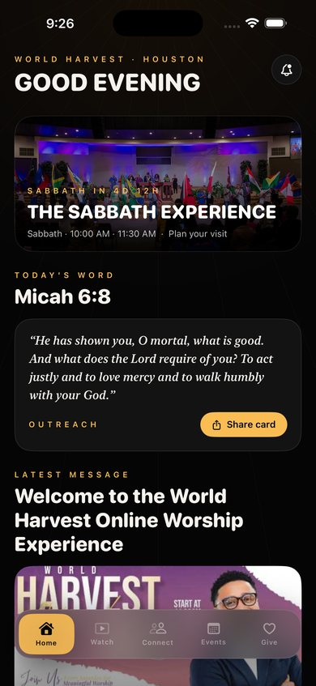 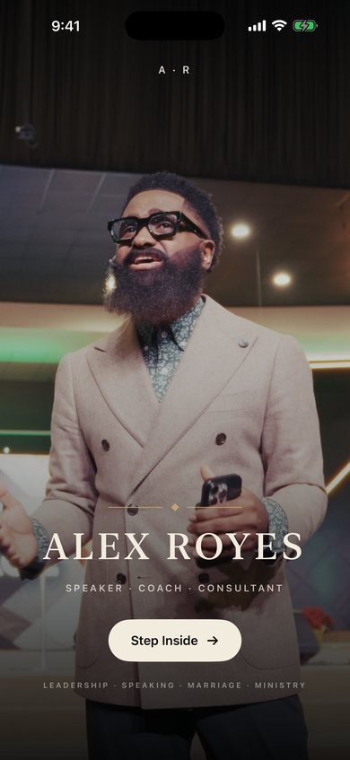 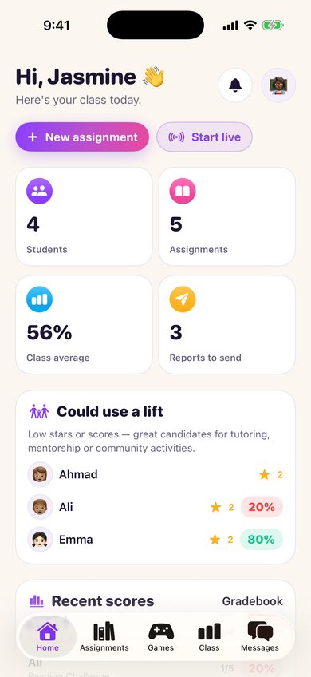 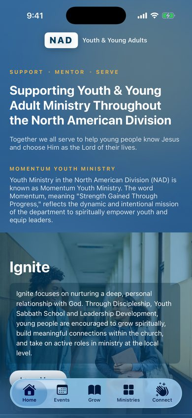

## At a glance

- **24 apps**, 23 native SwiftUI and 1 Expo/React Native.
- **One design system per client.** Each app has its own named visual language, palette and type, built from the client's brand and audience. Two apps from the same codebase family shouldn't look alike.
- **No third-party iOS dependencies** in the SwiftUI apps. Content comes from what the client already publishes: YouTube feeds, public calendars, their website.
- **Real content, not lorem ipsum.** Copy, schedules, ministries and links come from each client's own site and channels.
- Shipped through the App Store and TestFlight with a scripted pipeline: App Store Connect API for listings, `simctl` for screenshots.

## Apps

[WHO Worship](#who-worship) · [Alex Royes](#alex-royes) · [Village Applause](#village-applause) · [The Men's Winning Circle](#the-mens-winning-circle) · [NAD Youth](#nad-youth) · [Blueprint Church](#blueprint-church) · [16th Street SDA](#16th-street-sda) · [Lighthouse SDA](#lighthouse-sda) · [Campos da Norfolk](#campos-da-norfolk) · [FWP Center](#fwp-center) · [Alpha SDA](#alpha-sda) · [Trinity Worship Center](#trinity-worship-center) · [New Life Bronx](#new-life-bronx) · [New Life International](#new-life-international) · [New Jerusalem SDA](#new-jerusalem-sda) · [Victory SDA](#victory-sda) · [Ephesus SDA](#ephesus-sda) · [Lola Johnston](#lola-johnston) · [Orville Brissett](#orville-brissett) · [Coaxum Counseling](#coaxum-counseling) · [OFSIH Patient App](#ofsih-patient-app) · [EVOLVE Dentistry](#evolve-dentistry) · [Mexico Lindo Bakery](#mexico-lindo-bakery) · [Summer Moon (concept)](#summer-moon-concept)

### WHO Worship

**For:** Seventh-day Adventist church in Houston, TX 
**Design system:** "Harvest": near-black `#050506`, harvest amber `#ED8C1C`, sunrise gold `#F9BD54`, sky blue `#4294DB`; rounded heavy display type, sunrise-glow motif 
**Stack:** SwiftUI, iOS 17, no dependencies 
**Status:** Live on the [App Store](https://apps.apple.com/us/app/who-worship/id6788213778). Second generation of the church's app; the first version (World Harvest, same palette, countdown-first home) shipped to TestFlight.

- Landing film and a looping muted video behind the home screen
- Watch tab that separates full messages from short clips in the church's YouTube feed
- Prayer wall, events, sermon notes and saved messages
- Church forms and the weekly online prayer meeting one tap away
- Explicit link policy: only the church site and YouTube open in-app

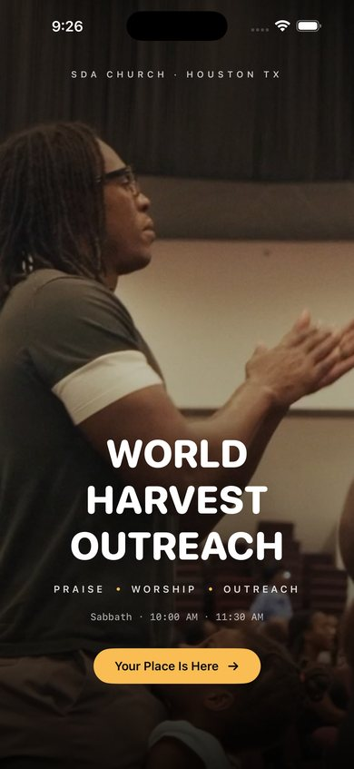  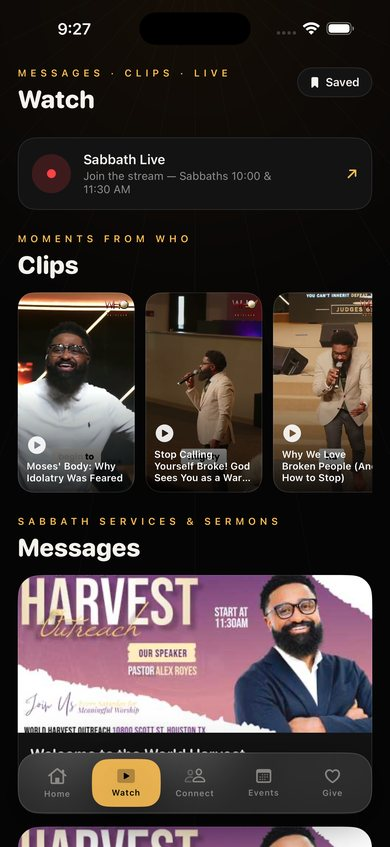

### Alex Royes

**For:** Personal-brand app for a pastor, speaker and leadership coach 
**Design system:** "Velour": ink green `#080B09`, velvet emerald `#274731`, bone cream `#F2ECDE`, champagne brass `#CAA96F`; serif display type, diamond rule ornaments 
**Stack:** SwiftUI, iOS 17, no dependencies; dependency-free Node script that pushes the App Store listing through the App Store Connect API 
**Status:** Production build (1.0) complete.

- Landing film on first launch
- Six coaching and speaking services with a rates sheet
- Booking calendar built on real office hours, request form, in-app mail composer and a 'My requests' list
- Giving routed to the church's own site

 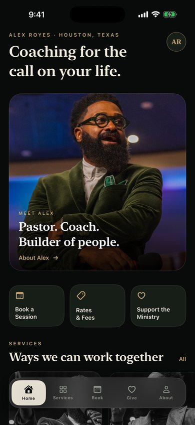 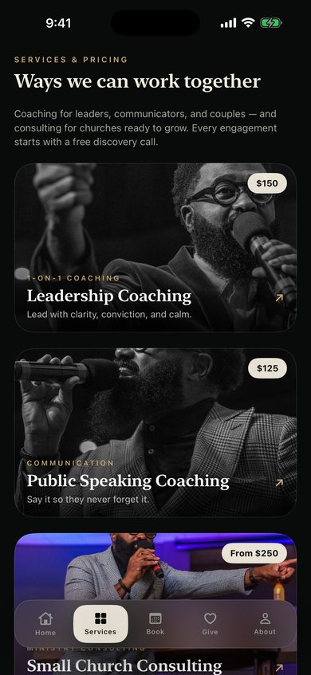

### Village Applause

**For:** School and family engagement program run by an education nonprofit 
**Design system:** "Royal & Gold": nonprofit purple and gold, Bricolage Grotesque display type, tactile pressable buttons, no emoji in the UI chrome 
**Stack:** SwiftUI, iOS 17, Network.framework (Bonjour); Node + `ws` relay server with tests; 100+ logic checks run against the real store code 
**Status:** On TestFlight. Runs on-device with seed data; backend integration is the next phase.

- Six roles: teacher, student, parent, connected adult (mentor, grandparent), school admin, program admin
- Assignments in Assignment mode (one attempt, no feedback) or Practice mode (instant feedback)
- Kahoot-style live quiz games across many phones: host-authoritative engine, Bonjour peer-to-peer or WebSocket relay
- Stars wallet, progress reports to families, and safety-flagged messaging with routes scoped by role and school

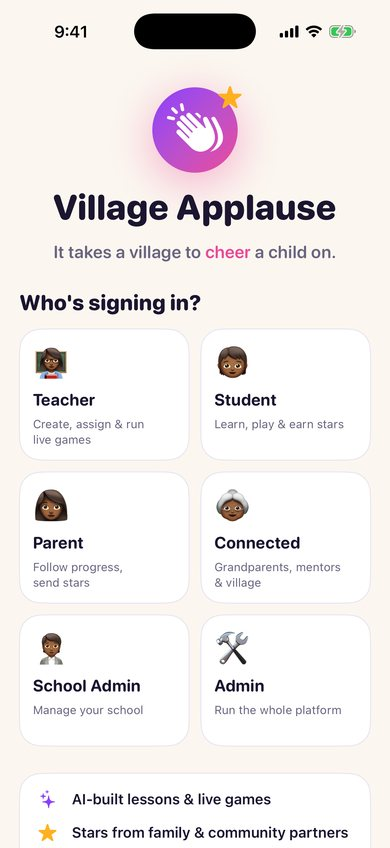  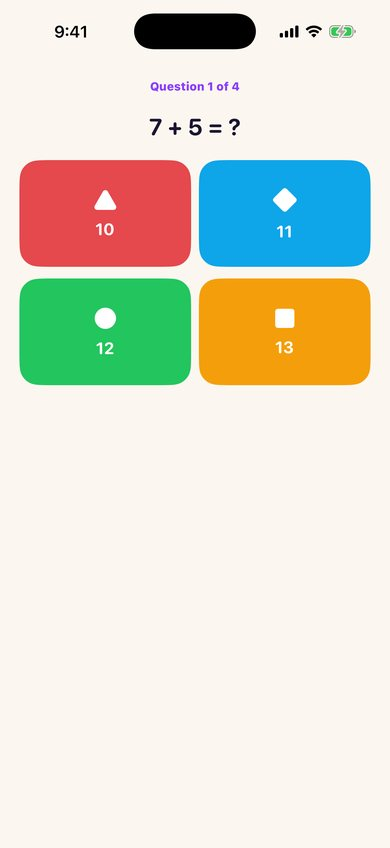

### The Men's Winning Circle

**For:** Membership community for faith-based men's coaching 
**Design system:** "Standard": black `#0B0A08` and gold `#C9A24B`, Fraunces + Inter 
**Stack:** Expo (React Native, TypeScript, Expo Router) + Supabase (auth, Postgres) 
**Status:** Phase 1 built against a live Supabase backend.

- Daily SHIFT check-in across five dimensions (Spiritual, Health, Integrity, Family, Tribe) with a radar dashboard and 30/60/90-day trends
- Momentum score with grace decay instead of hard streak resets
- Accountability pods of 6-8 members with feed, nudges and leaderboard
- Challenges, badges and levels; content library; member directory; tier-gated content

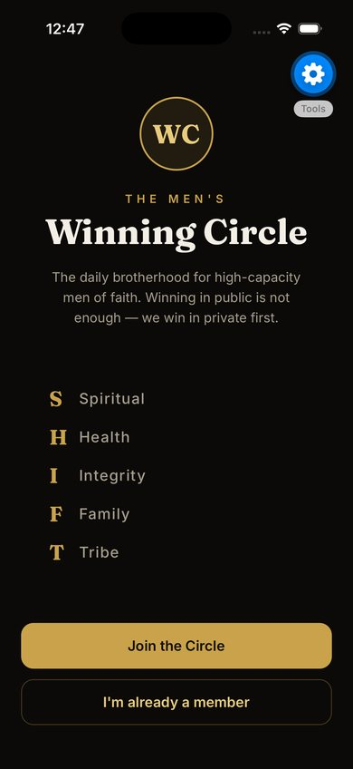 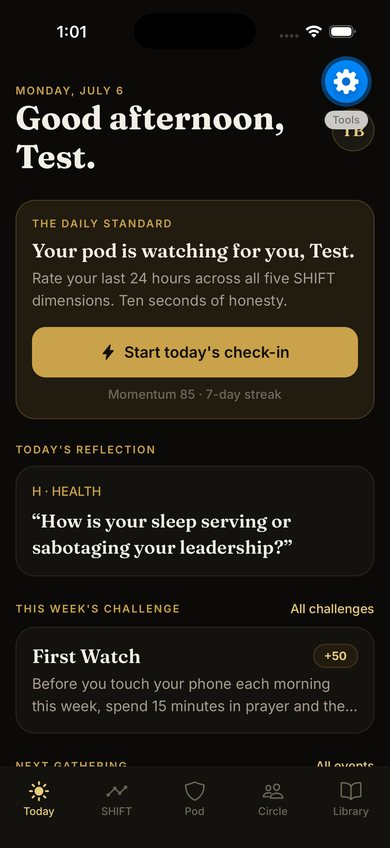 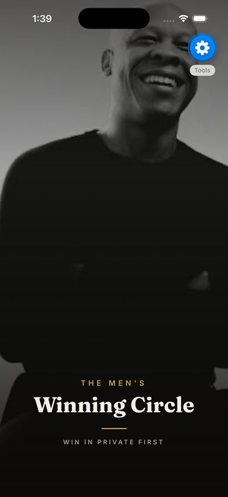

### NAD Youth

**For:** Youth and young adult ministries department of a North American church division 
**Design system:** "OneTeam": royal blue field `#33699C` to `#1E4E7E`, deep navy `#023B5C`, gold `#E9B44C`; drifting blurred-orb animated background, dark glass cards 
**Stack:** SwiftUI, iOS 17, no dependencies 
**Status:** Prototype delivered with a client proposal.

- Auto-advancing resources carousel that mirrors the website's
- Native events calendar parsed from the division's public Google Calendar ICS feeds
- Studies, media and devotionals with filters
- Ministry directory, local prayer wall, every link opens in-app

 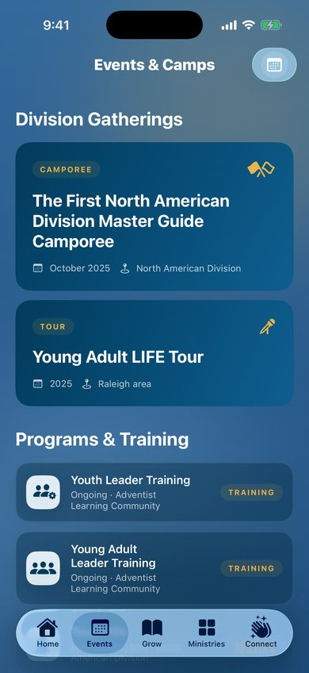 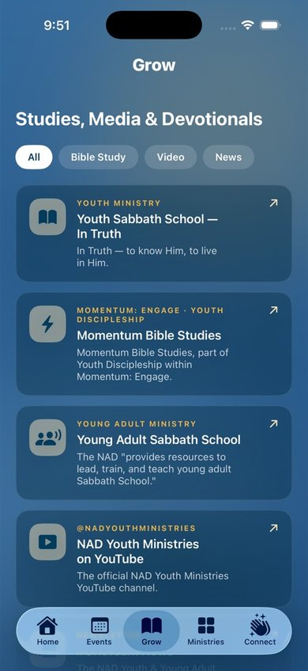

### Blueprint Church

**For:** Non-denominational church in Houston, TX 
**Design system:** "Draft": ink navy `#0B1120`, cobalt `#2E6BE6`, jersey gold `#F2B33D`; drafting-grid canvas motif, condensed heavy type, glass pills 
**Stack:** SwiftUI, iOS 17, UserNotifications 
**Status:** Prototype.

- Hero video landing
- Local notifications: Sunday reminder, daily verse, RSVP nudges
- Shareable 1080x1920 verse cards (ImageRenderer + ShareLink)
- On-device prayer wall with 'I prayed' counts
- Events with RSVP, sermon notes, Shorts rail

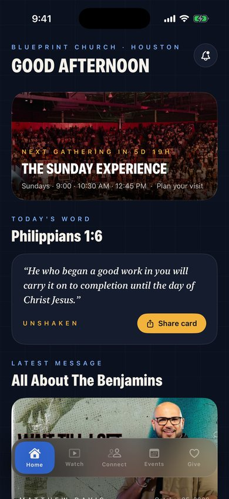 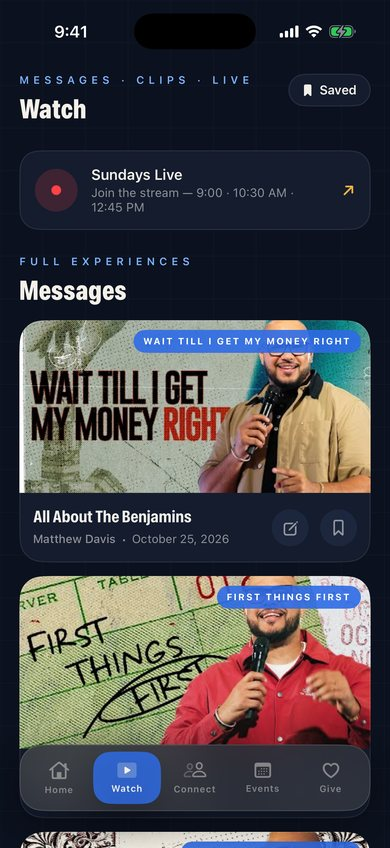

### 16th Street SDA

**For:** Seventh-day Adventist church in San Bernardino, CA 
**Design system:** "Marquee": gallery black `#0A0A0B`, bone pearl `#FAF9F6`, warm brass `#C7A876`, silver kickers; street-grid canvas motif 
**Stack:** SwiftUI, iOS 17 
**Status:** Prototype.

- Photo landing with a slow Ken Burns push-in
- Sermon list parsed from 'Title | Speaker' video titles
- Prayer wall, verse cards, events
- Ministries and online giving

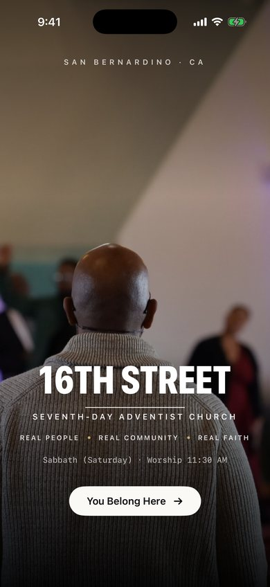 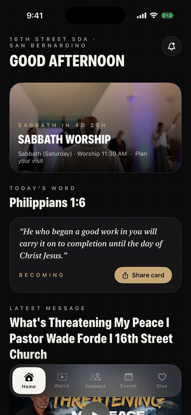

### Lighthouse SDA

**For:** Seventh-day Adventist church in Fort Lauderdale, FL 
**Design system:** "Beacon": deep ocean-navy gradient, warm orange beacon accents, aqua-green secondary; serif display type 
**Stack:** SwiftUI, iOS 17 
**Status:** Prototype.

- Countdown to the next service that switches to LIVE during service windows
- Messages filtered to the senior pastor's sermons, with chips for other programs
- Twelve ministries with detail sheets
- Giving options

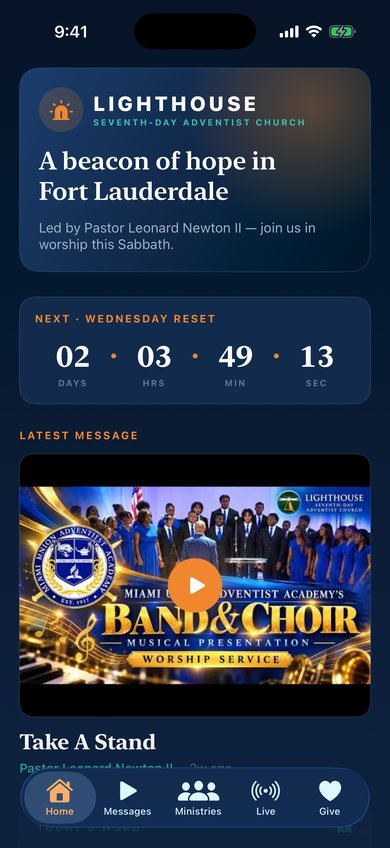

### Campos da Norfolk

**For:** Seventh-day Adventist church in Norfolk, VA 
**Design system:** Adaptive navy and gold: deep navy `#1B365D`, warm gold, cream white; Color Set assets with a designed dark mode (muted slate blue, not black) 
**Stack:** SwiftUI, iOS 17 
**Status:** Prototype.

- Ministries shown as full-bleed site photography
- Messages with category chips
- Live tab with multi-service countdown
- Giving

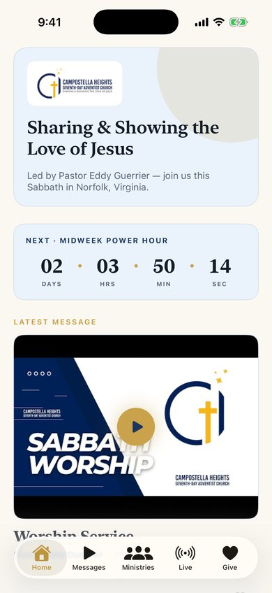 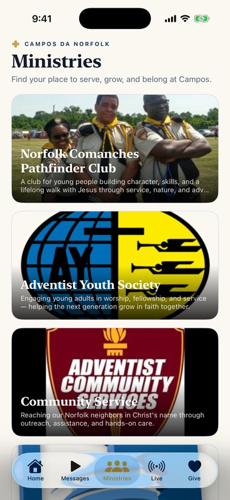

### FWP Center

**For:** Seventh-day Adventist church in White Plains, NY 
**Design system:** "Vesper": ivory and parchment, deep wine `#6B2138`, brass `#E0A458`; Sabbath-sunset gradient hero, serif display 
**Stack:** SwiftUI, iOS 17 
**Status:** Prototype.

- Sermons from the church's YouTube feed
- Live stream
- Ministries and connect
- The project shell later reused for a batch of church apps

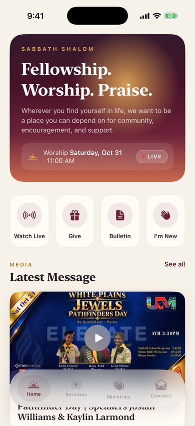

### Alpha SDA

**For:** Seventh-day Adventist church in Austin, TX 
**Design system:** "Genesis": paper, petrol teal and copper; heavy sans with mono kickers; matched-geometry segmented tab bar 
**Stack:** SwiftUI, iOS 17 
**Status:** Prototype.

- Sermons
- Ministries
- Connect and giving

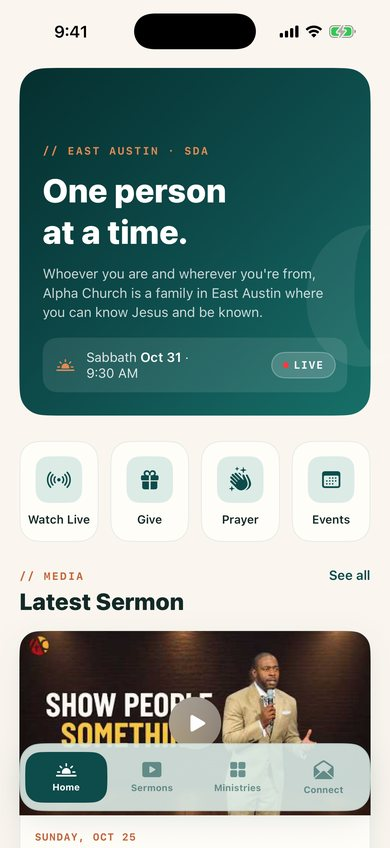

### Trinity Worship Center

**For:** Church in Burlington, NC 
**Design system:** "Haven": cream, evergreen and terracotta; rounded type; interlocking-rings motif; dark green dock 
**Stack:** SwiftUI, iOS 17 
**Status:** Prototype.

- Sermons
- Ministries
- Connect and giving

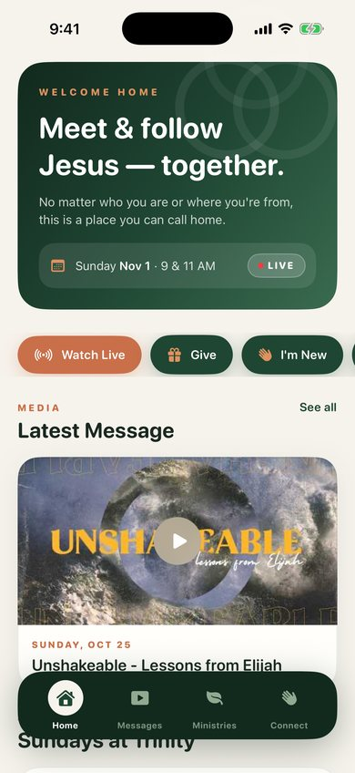

### New Life Bronx

**For:** Bilingual English/Spanish church in the Bronx, NY 
**Design system:** "Transit": concrete, cobalt and subway yellow; black grotesk; route-line motif 
**Stack:** SwiftUI, iOS 17 
**Status:** Prototype.

- Sermons
- Ministries
- Connect and giving

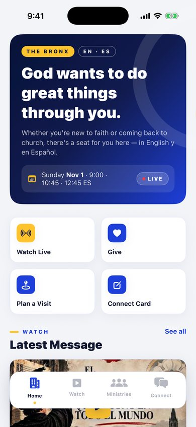

### New Life International

**For:** House church in Houston, TX 
**Design system:** "Radiance": lilac, violet and gold; light serif; radiant-rays motif 
**Stack:** SwiftUI, iOS 17 
**Status:** Prototype.

- Sermons
- Prayer line
- Ministries and connect

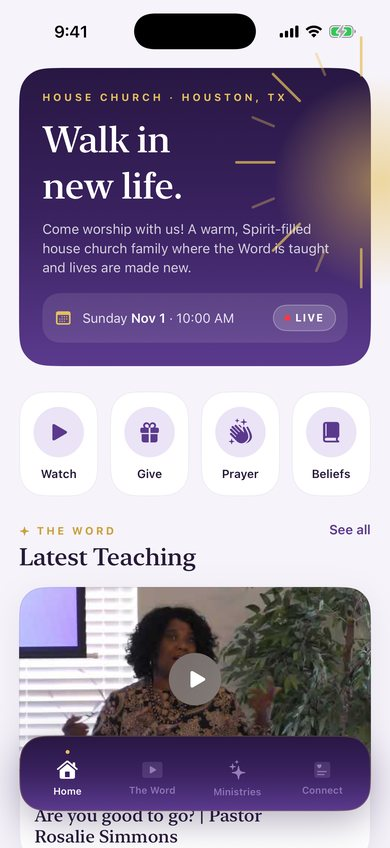

### New Jerusalem SDA

**For:** Seventh-day Adventist church in East St. Louis, IL 
**Design system:** "Jasper City": pearl, sapphire to amethyst, gold; condensed type; arched-gate motif 
**Stack:** SwiftUI, iOS 17 
**Status:** Prototype.

- Sermons
- Service times including online prayer meeting and radio broadcast
- Ministries and giving

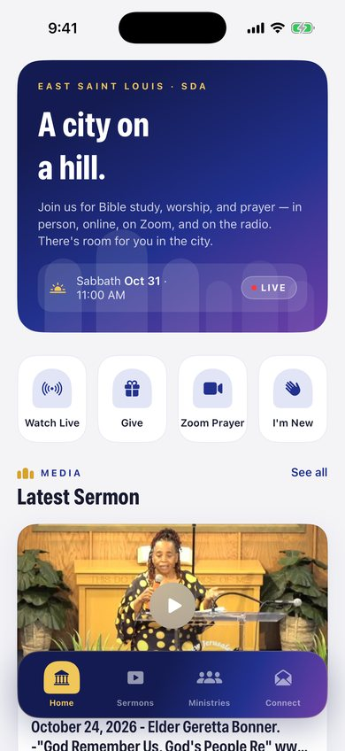

### Victory SDA

**For:** Seventh-day Adventist church in Port St. Lucie, FL 
**Design system:** "Hibiscus Sunrise": shell, mulberry hibiscus and mango; italic serif; palm-branch motif 
**Stack:** SwiftUI, iOS 17 
**Status:** Prototype.

- Sermons
- Grow tab of trusted study resources
- Connect and giving

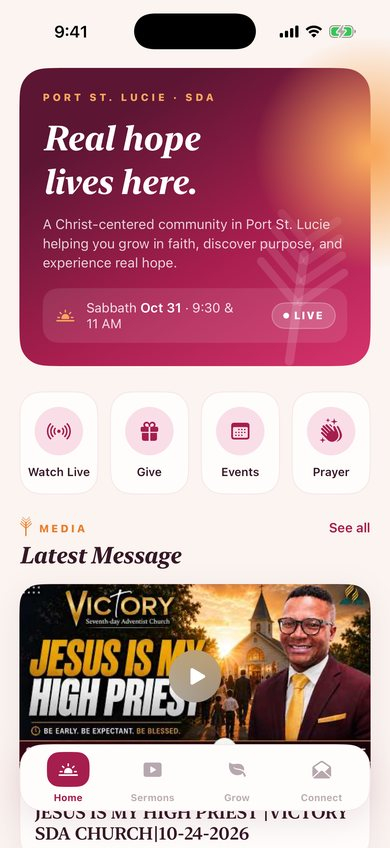

### Ephesus SDA

**For:** Seventh-day Adventist church in West Palm Beach, FL 
**Design system:** "Lampstand": charcoal night with flame amber; serif; the only always-dark app in its batch 
**Stack:** SwiftUI, iOS 17 
**Status:** Prototype.

- Sermons and podcast archive
- Grow tab
- Connect and giving

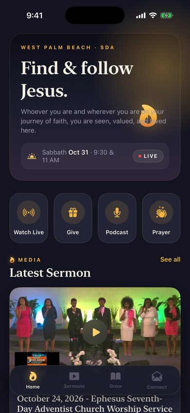

### Lola Johnston

**For:** Personal-brand app for a pastor, speaker and author 
**Design system:** "Petal": blush `#FBF1ED`, plum ink `#3A1A2C`, fuchsia `#D9276F` to coral; serif with script accents, frosted glass cards 
**Stack:** SwiftUI, iOS 17 
**Status:** Prototype.

- Booking inquiry form with a local requests list
- Six-module framework with a progress ring
- Guided journal prompts
- Daily affirmations with sharing
- Testimonials, keynotes and media

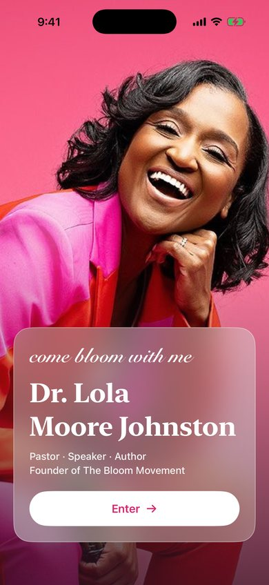 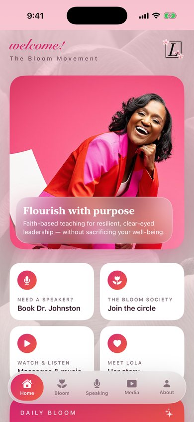

### Orville Brissett

**For:** Personal-brand app for a coach, consultant and weekly show host 
**Design system:** "Signal": graphite `#070A0F`, azure `#29BAE8`, cobalt `#12437F`, platinum, one gold accent; three-bar rule ornament 
**Stack:** SwiftUI, iOS 17 
**Status:** Prototype.

- Services and request-a-time booking
- Show tab with episodes and a next-episode card
- Quote cards
- No in-app payments by design

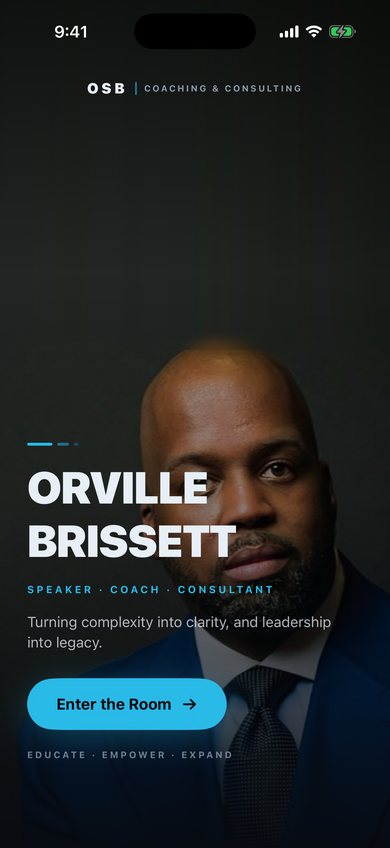 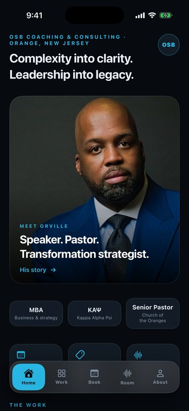

### Coaxum Counseling

**For:** Client app for a licensed therapist and relationship coach 
**Design system:** "Study": greige `#F1EEE8` / umber `#1C1814`, walnut and taupe, muted bronze `#7E6844`; liquid-glass surfaces over a desaturated photo backdrop 
**Stack:** SwiftUI, iOS 17 
**Status:** Design prototype with mock data.

- Mood check-in and next-session card
- Session booking
- Secure-style messaging with a 988 crisis notice
- Journal prompts
- Goals with progress rings, worksheets and short lessons

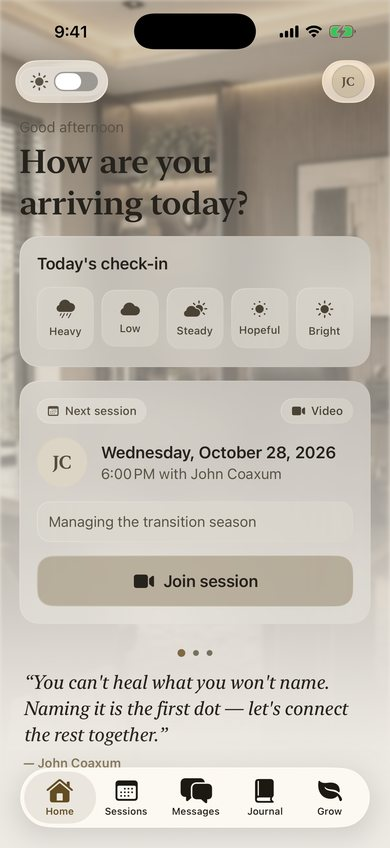

### OFSIH Patient App

**For:** Oral and facial surgery practice in Houston, TX 
**Design system:** "Calm Clinic": ocean navy `#03405A`, soft cream `#FAF7F1`, sage `#6F9673`, mint `#82CD8D`, terracotta `#C08757`; floating glass tab bar with a raised Book button 
**Stack:** SwiftUI, iOS 17, MapKit 
**Status:** Prototype.

- Onboarding and a native port of the site's scrolling specials banner
- Searchable treatments index with detail pages
- Pre-op checklist (persisted) and day-by-day recovery timeline
- Three-step booking wizard
- Practice page with MapKit map of both offices

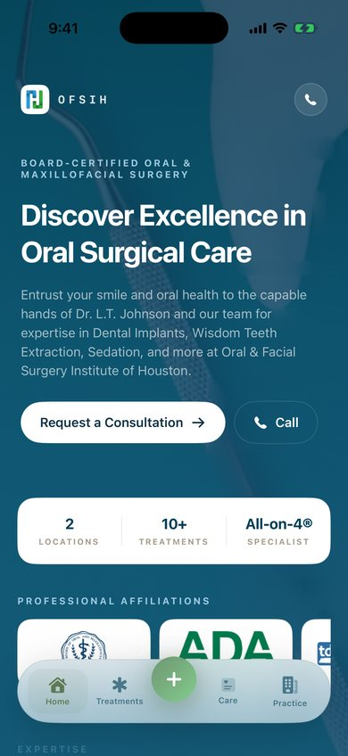 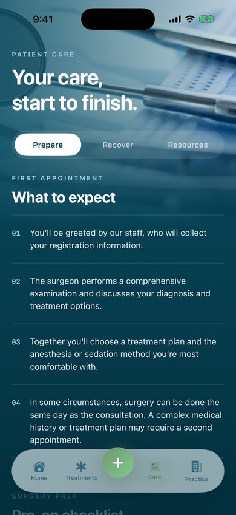

### EVOLVE Dentistry

**For:** Dental practice in Missouri City, TX 
**Design system:** Black and champagne: ink black, cream and warm champagne gold 
**Stack:** SwiftUI, iOS 17 
**Status:** Prototype.

- Services and doctors
- Booking hand-off to the practice's online scheduler
- Hours, contact and Apple Maps directions

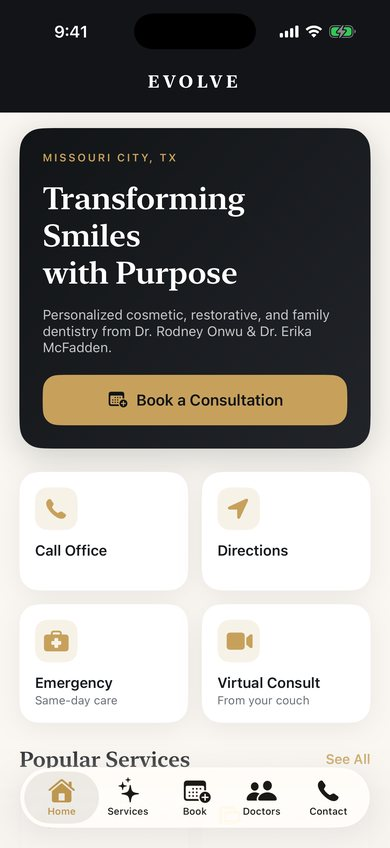

### Mexico Lindo Bakery

**For:** Family-owned Mexican bakery near Houston, TX 
**Design system:** Panaderia warm: warm bakery tones with gradient product art 
**Stack:** SwiftUI, iOS 17 
**Status:** Prototype with mock data.

- Points rewards (10 per $1) with four tiers
- Menu and item detail
- Mobile order flow
- Scan-to-earn

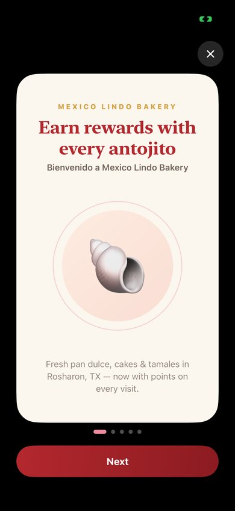

### Summer Moon (concept)

**For:** Rewards and ordering concept for a Texas coffee chain 
**Design system:** "Oak & Moon": linen `#F8F2E7`, espresso `#241B10`, oak gold `#B07E28`, ember `#A8471F`, midnight `#121A2B`; moon-phase discs for rewards progress and sweetness levels 
**Stack:** SwiftUI, iOS 17 
**Status:** Concept prototype with mock data.

- Onboarding carousel
- Order with pickup method (curbside, in cafe, drive-thru) and location picker
- Deals with add-to-order or QR
- Points with redemption tiers

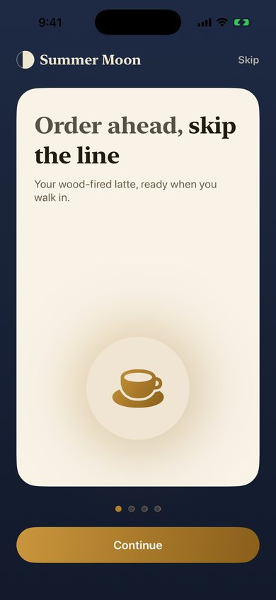

## How these are built

Most of the SwiftUI apps share one small architecture: a synchronized Xcode project with no packages, a single design-token file per app, YouTube sermon feeds read without an API key, a schedule-driven countdown, local-first stores, one-sheet-per-screen navigation and an explicit in-app link policy. See [ARCHITECTURE.md](ARCHITECTURE.md).

## Work with the studio

Royz Media Group: **[royzmediagroup.com](https://royzmediagroup.com)**

---

Screenshots are from the iOS Simulator or the apps' App Store listings. App names and brands belong to their respective organizations.

Built by [Ian Royes](https://github.com/ianroyes-sys).
